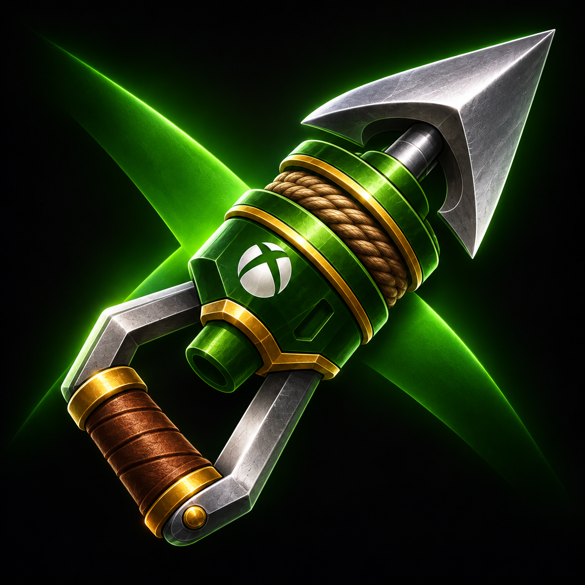

<p align="center">
  
</p>

# Longshot Xbox

**Longshot Xbox** is an experimental Xbox Series X|S Developer Mode port maintained in this repository by **Yeetbot159**. It adapts the original [Longshot project](https://git.magicbean.dev/MagicBeanDev/Longshot), a static recompilation of a Nintendo Switch 2 game, for Xbox's UWP app model.

> [!WARNING]
> **Xbox gameplay is not verified yet.** The launcher and console builder are prototypes. The renderer now includes guest-address translation and a descriptor-backed mesh fallback for systems without Vulkan buffer device addresses; these paths remain experimental, and PC simulation is not proof of Series S gameplay.

This repository contains the Xbox-specific app, renderer packaging, builder, loader, probe, and integration changes. It does not contain the game, game keys, or game-derived files.
The supplied Xbox hookshot artwork is used for launcher and package branding, the website, and the compiled game's start-up logo.

## Project status

| Part | Status |
| --- | --- |
| Launcher app | Builds as a sideloadable UWP package; finds player files on removable storage and selects Series S or Series X build settings. |
| On-console builder | Prototype packages CPython, its dependencies, and llvm-mingw. It has not yet completed a game build on an Xbox. |
| Game module and loader | UWP host shims and a PE module loader are included. The module must be built from the player's own files. |
| Vulkan renderer | `longshot_vk.dll` and Mesa Dozen are packaged. A PC simulation exercised the no-BDA/no-mesh fallback and rendered through Kokiri Forest; Series S renderer startup and gameplay remain unverified. |
| Capability probe | Measures UWP, memory, storage, input, audio, and D3D12 features. The latest probe source checks Dozen's `ID3D12Device13::OpenExistingHeapFromAddress1` path and GPU access through imported memory. |
| Series S and X hardware | Series S probe data is available in the task history; no Series X probe result has been collected. Whole-console hardware specifications do not describe the resources available to a UWP app. |

### Renderer limitation

The Series S UWP device reports shader model 6.4. Mesa Dozen exposes Vulkan buffer device addresses only with shader model 6.6 or later, while the current guest shaders use physical storage-buffer pointers. The renderer now translates guest addresses through a bounded pool and has descriptor-backed task/mesh fallback paths when BDA is unavailable. A PC run with `RX_VK_NO_BDA=1` and `RX_VK_NO_MESH=1` reached Kokiri Forest, but unsupported draws remain and no Series S run has confirmed the same behavior.

The reported mesh-shader tier is for the current UWP/Dozen path. Microsoft documents native mesh-shader pipelines on Series X|S devkits through GDK; this UWP measurement does not establish the console silicon's full graphics capabilities.

The Xbox profiles cap VMA-managed renderer allocations at up to 2 GB on Series S and 4 GB on Series X, dynamically limited to half of the expected app-memory limit when the platform reports it. Imported-pool mirrors are capped separately at 256 MB and 512 MB. These are renderer allocator limits, not whole-process limits: game/host allocations and non-VMA imports are not included. The Series S profile is based on a measured 5 GB app limit; the Series X 8 GB profile is not yet verified by a probe.

## Releases

Download the game-free app, probe, and public signing certificate from [GitHub Releases](https://github.com/Yeetbot159/Longshot-Xbox/releases). Releases are experimental prereleases. The `xbox-v*` tag workflow builds and publishes:

- `Longshot.msix` — launcher, Xbox host, renderer, Mesa Dozen runtime, and builder tools.
- `LongshotXboxProbe.msix` — hardware and capability probe.
- `LongshotXbox.cer` — public certificate required to install the sideloaded packages.

Install only packages from a release you trust. The certificate is public and is used to verify these packages; it does not contain a private signing key.

## Install and collect a probe

1. Enable Developer Mode on the Xbox and use Dev Home to install the certificate and `.msix` packages. Trust the certificate in the device's trusted people store before installing the signed packages.
2. Set the probe's app type to **Game** in Dev Home when collecting memory measurements.
3. Run `LongshotXboxProbe` from Dev Home. It writes `probe.txt` and `probe.json` to its LocalState folder as it runs.
4. Share the probe output when reporting a renderer or builder issue. The files describe device capabilities and contain no game dump.

The launcher currently expects the player's game files on removable storage. It does not download or include those files.

## Build from source

### Xbox packages

Use Windows with Visual Studio C++ build tools, the Windows SDK, PowerShell, Python, and the dependencies listed in the workflow. The local package scripts are:

```powershell
powershell -ExecutionPolicy Bypass -File xbox\probe\build.ps1 -Version 0.2.3.0
powershell -ExecutionPolicy Bypass -File xbox\app\build.ps1 -Version 0.2.3.0
```

Local MSIX signing uses a self-signed certificate and may require elevated Windows certificate permissions. The GitHub Actions workflow builds the renderer and packages, signs them on its Windows runner, and publishes a prerelease when an `xbox-vMAJOR.MINOR.PATCH` tag is pushed.

The CI workflow is the authoritative full package build. It compiles `longshot_vk.dll` for UWP, includes Mesa Dozen and the console builder tools, runs the launcher and host checks, and builds both MSIX packages.

### Building a game module

The console builder is experimental and still requires an Xbox run to prove that Python, clang, linking, storage access, and memory use work together. To build the module on a PC instead, use the original Longshot build pipeline with an llvm-mingw toolchain:

```powershell
$env:LONGSHOT_XBOX = '1'
$env:LONGSHOT_MINGW = '<path to llvm-mingw>'
python -I nx2\make_game.py --romfs '<your game files>\romfs' --exefs '<your game files>\exefs' --out '<output folder>' --work '<work folder>' --no-prepare-shaders
```

Build and use only from files you are entitled to use. Do not commit, upload, or distribute game files, keys, generated game modules, lifted code, or other game-derived output.

## How it is put together

- `xbox/app` — UWP launcher, console model and memory reporting, options, removable-drive discovery, audio, and package manifest.
- `xbox/probe` — UWP D3D12 and system capability probe.
- `xbox/loader` — PE module loader used by the app.
- `host/uwp` — UWP platform interface and desktop API shims for the game module.
- `gpu/vk` — Longshot's Vulkan renderer, built as `longshot_vk.dll` for Xbox.
- `.github/workflows/xbox.yml` — builds game-free Xbox packages and publishes tagged prereleases.
- `xbox/README.md` — detailed implementation notes, capability findings, and current technical limitations.

## License

Longshot is free software under the [GNU General Public License, version 3 or later](https://git.magicbean.dev/MagicBeanDev/Longshot/src/branch/main/LICENSE) (GPL-3.0-or-later). This Xbox port adapts Longshot, which is a modified version of Hookshot, released by NotRexed under the same license. The changes made to Longshot since that fork belong to the Longshot project; the Xbox-specific changes are maintained in this repository by Yeetbot159 and contributors. See [`LICENSE`](LICENSE), and preserve the notices already present in source files.

```yaml
Hookshot: Copyright (C) 2026 NotRexed and the Hookshot contributors
Longshot: Copyright (C) 2026 the Longshot contributors
```

Longshot includes code from Eden and suyu, also under the GPL. Third-party components under compatible licenses keep their own notices in their folders, including Sirit, the Vulkan Memory Allocator, SDL, Opus, Dear ImGui, zstd, the Libertinus fonts, zbic, and the a64-kit tools. Mesa Dozen and the Xbox package's other components retain their own licensing terms as well.

Longshot is an unofficial fan project, not affiliated with or endorsed by Nintendo. The Legend of Zelda and Ocarina of Time are trademarks of Nintendo.

## Credits

This repository builds on the original [Longshot project](https://git.magicbean.dev/MagicBeanDev/Longshot) and its contributors. The Xbox launcher, UWP host integration, capability probe, package workflow, and console port work here are maintained by Yeetbot159 and contributors.

- **NotRexed**: [Hookshot](https://github.com/NotRexed/Hookshot), the project Longshot forked from, plus BlueShell (Mario Kart World), Skybound (Tears of the Kingdom), and the a64-kit tools.
- [**Eden**](https://git.eden-emu.dev/eden-emu/eden) and **Eglantine**: shader recompiler and Switch 2 shader work.
- **suyu**: graphics decoders and the AArch64 translator.
- [**seedds/nxnative**](https://github.com/seedds/nxnative): reference for task and mesh shaders.
- [**EvilBoyce / evilmfkr**](https://github.com/evilmfkr/Hookshot) (EvilOOT): GPU culling, ambient light probes, pond water, game fog, and other graphics fixes carried by Longshot.
- [**zortos293/Lichii**](https://github.com/zortos293/Lichii): reference for Ampere shader lowering and its compare-exchange retry fix.
- [**Mesa**](https://www.mesa3d.org/): Dozen, the Vulkan-on-Direct3D 12 driver packaged for Xbox, and graphics compiler work used by the original project.
- [**mstorsjo/llvm-mingw**](https://github.com/mstorsjo/llvm-mingw): the Windows compiler toolchain used to build game modules.
- **kinnay/zbic, Opus, and SDL**: decompression, audio, and controller support in the original Longshot codebase.
- **NVIDIA DLSS and AMD FidelityFX**: optional technologies supported by the original Longshot project. Their SDKs, runtime files, and license terms belong to NVIDIA and AMD; they are not bundled in these Xbox packages.
- Everyone who contributed fixes and testing to Longshot, including SkippySteve, monsterlag, klimovich008, hckrman101, madebyjordan, N3oTraX, shayderrr, gab9281, Wpaif, nicholasgower, ZurielAtr, Joey-Magnus, Zorkats, d3zessete, chrispository, vzeol, leonidasmark, Segmentree, ShyVortex, hiKareeem, and i900gaming.

## Contributing

Bug reports and code contributions for the Xbox port belong in [this repository's Issues and Pull Requests](https://github.com/Yeetbot159/Longshot-Xbox). Include the Xbox model, Dev Mode setup, release version, and relevant probe or launcher logs. Never attach game files or generated game data.

For changes to the original Longshot project, use its [upstream repository](https://git.magicbean.dev/MagicBeanDev/Longshot) and follow its [contribution guide](https://git.magicbean.dev/MagicBeanDev/Longshot/src/branch/main/CONTRIBUTING.md).
